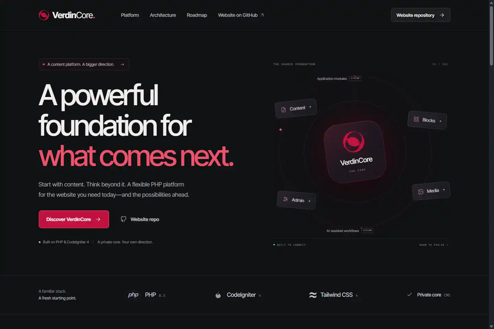
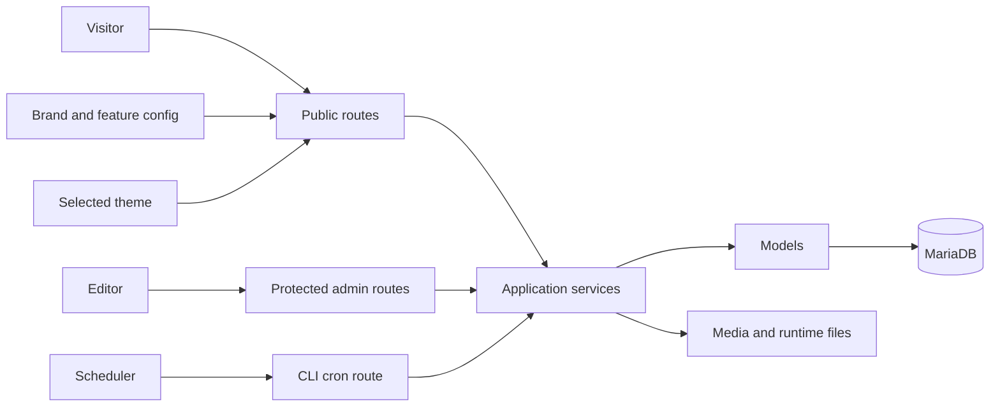

# VerdinCore

VerdinCore is a private, multi-brand content management platform built with CodeIgniter 4. It brings publishing, reusable content blocks, media processing, authentication, analytics, search visibility, and routine maintenance into one application.

[Website](https://verdincore.com) | [Documentation](docs/README.md) | [Roadmap](docs/product/roadmap.md)

## About this repository

This public repository contains the VerdinCore product and technical documentation. The application source is maintained separately and is not distributed here.

The documentation is based on VerdinCore `4.0.1`. It covers the current application, including installation and operations guidance for authorized users who have access to the private source.

## What VerdinCore does

VerdinCore runs distinct websites from a shared application core. A deployment selects a brand, a public theme, and a set of site features. The publishing rules, administration tools, data model, security controls, and maintenance services remain common.

Current capabilities include:

- posts and hierarchical pages with four publication states, a review flag, and a trash workflow;
- public and member-only content;
- topic groups, topics, archives, search, related posts, and configurable featured content;
- reusable blocks composed from text, rich text, links, and images;
- managed image uploads, AVIF variants, social images, and orphan cleanup;
- CodeIgniter Shield authentication, email-code activation, and permission-based administration;
- per-deployment brand identity, social links, Schema.org data, and theme selection;
- RSS, canonical metadata, XML sitemaps, `robots.txt` management, and structured data;
- first-party visitor statistics and post view counts;
- production page caching and a coordinated daily maintenance workflow.

## Technology baseline

| Area | Current baseline |
| --- | --- |
| Runtime | PHP 8.5 |
| Framework | CodeIgniter 4.7 |
| Authentication | CodeIgniter Shield 1.4 |
| Database | MariaDB or compatible MySQL, InnoDB, `utf8mb4` |
| Front end | Server-rendered PHP, Tailwind CSS 4, daisyUI 5 |
| Editor | Tiptap 3 |
| Browser bundles | esbuild |
| Testing | PHPUnit 10 |

## Architecture in one view

Start with the [platform overview](docs/product/overview.md), then read the [architecture guide](docs/architecture/system.md) or follow one of the paths on the [documentation home](docs/README.md).

## Repository status

VerdinCore is actively developed in a private repository. Statements marked as current have been checked against application version `4.0.1`. Planned work is kept in the [roadmap](docs/product/roadmap.md) and is not presented as available functionality.

## License

VerdinCore is proprietary software. Access to code or documentation does not grant permission to use, copy, modify, or distribute the application. See [LICENSE](LICENSE) for the full terms.

## Feedback

Documentation corrections are welcome through this repository's issue tracker. Do not post credentials, private URLs, personal data, exploit details, or infrastructure information in a public issue.
