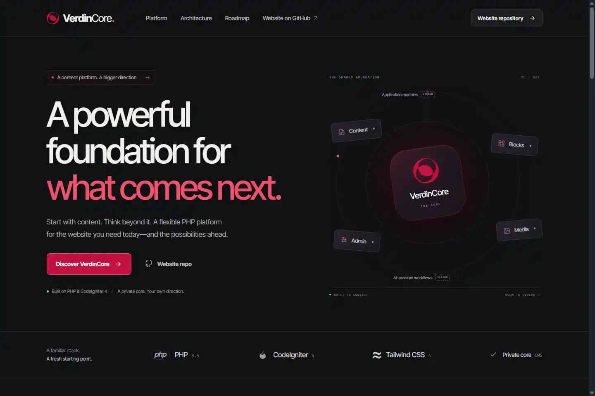
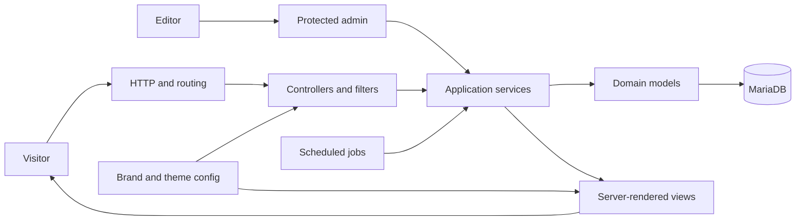

# VerdinCore

**A modular, multi-brand content platform built for focused publishing and long-term evolution.**

[Visit verdincore.com](https://verdincore.com) | [Explore the documentation](docs/README.md) | [View the roadmap](docs/roadmap.md)

## About this repository

This is the public repository for the VerdinCore website and product documentation. It explains the platform, its architecture, its content model, and the ideas that guide its development.

The production CMS source code is maintained in a separate private repository. This repository is therefore a product and architecture reference, not an installable VerdinCore distribution.

## What is VerdinCore?

VerdinCore is a private PHP content platform for running distinct websites from a shared application foundation. Each site can define its own identity, domain, assets, social presence, structured data, feature set, and theme while retaining the same tested publishing core.

It combines a structured CMS, reusable content blocks, media processing, discoverability tools, first-party analytics, and operational automation in one compact system.

## Why VerdinCore

- **One foundation, distinct brands.** Share platform capabilities without flattening every website into the same identity.
- **Structured where it matters.** Pages, posts, topics, topic groups, media, and reusable blocks have explicit models and relationships.
- **A focused publishing workflow.** Draft, schedule, publish, archive, restore, and permanently remove content from a purpose-built admin area.
- **Discoverability by default.** Canonical metadata, social previews, Schema.org data, RSS, sitemaps, and robots directives are part of the platform.
- **Operational work is automated.** Scheduled publishing, analytics summaries, media cleanup, sitemap generation, session cleanup, and optional GitHub synchronization run as managed jobs.
- **Private by design.** The core remains controlled while its architecture and direction are documented in public.

## Key capabilities

| Area | Capabilities |
| --- | --- |
| Content | Hierarchical pages, posts, excerpts, featured content, topics, topic groups, related content, and archives |
| Editing | Rich text editing, embeds, image insertion, slug generation, validation, sanitization, and transactional saves |
| Blocks | Reusable block groups with text, rich text, link, and image elements |
| Media | Validated uploads, generated image variants, responsive delivery, and orphan cleanup |
| Multi-brand | Per-brand identity, contact details, domain, locale, social links, assets, and structured identity |
| Delivery | Server-rendered pages, optional production page caching, RSS, XML sitemaps, and compressed sitemaps |
| Administration | Protected dashboard, content filtering, trash and restore workflows, user management, analytics, logs, cron history, and system information |
| Operations | Scheduled publishing, privacy-conscious visitor statistics, bot filtering, maintenance jobs, and test coverage for core services |

## Architecture at a glance

VerdinCore follows a layered CodeIgniter 4 architecture. HTTP controllers stay close to request handling, application services hold business rules, models manage persistence, and themes own presentation. Brand configuration and feature flags adapt the shared core for each deployment.

Read the [architecture guide](docs/architecture.md) for the full system view.

## Technology

| Layer | Technology |
| --- | --- |
| Runtime | PHP 8.5 |
| Framework | CodeIgniter 4.7 |
| Authentication | CodeIgniter Shield |
| Database | MariaDB |
| UI | Server-rendered PHP views, Tailwind CSS 4, daisyUI 5 |
| Editing | Tiptap 3 |
| Assets | esbuild and Tailwind CSS CLI |
| Testing | PHPUnit 10 |

## Documentation

- [Documentation home](docs/README.md)
- [Platform overview](docs/overview.md)
- [Features](docs/features.md)
- [Architecture](docs/architecture.md)
- [Content model](docs/content-model.md)
- [Security and operations](docs/security-and-operations.md)
- [Roadmap](docs/roadmap.md)

## Project status

VerdinCore is under active private development. The documentation describes capabilities present in the current core unless a section is explicitly marked as roadmap.

Public documentation will grow alongside the platform. The absence of the CMS source from this repository is intentional.

## Feedback

Questions and documentation feedback are welcome through this repository's issue tracker. Security-sensitive information should not be posted publicly.
