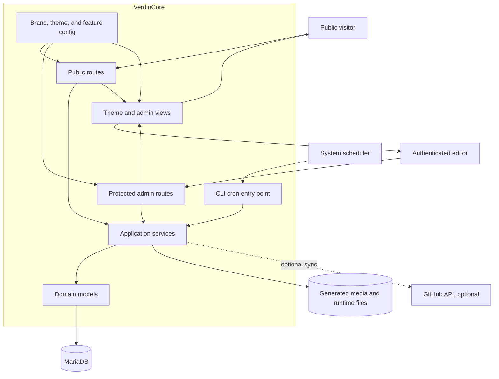
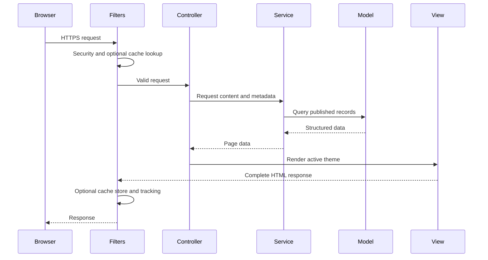

# Architecture

## System context

VerdinCore is a server-rendered PHP application with a protected administration surface and a public website surface. Both use the same application services and relational data model. Deployment configuration selects the active brand, theme, and optional platform features.



## Application layers

| Layer | Responsibility |
| --- | --- |
| Routing and filters | Map explicit HTTP and CLI entry points, enforce HTTPS, CSRF checks, authorization, caching, tracking, secure headers, and performance metrics |
| Controllers | Translate requests into focused application operations and choose responses or views |
| Application services | Own publishing, validation, sanitization, blocks, analytics, metadata, structured data, tracking, and recurring job behavior |
| Models | Express database rules, queries, relationships, publication scopes, and persistence validation |
| Cells and views | Render reusable server-side UI components, pages, layouts, navigation, and admin screens |
| Brand and feature configuration | Supply identity, site metadata, theme selection, capability flags, and operational tuning |
| Build pipeline | Compile Tailwind CSS and bundle browser JavaScript for public and admin interfaces |

The service layer is the main boundary for business behavior. Controllers remain relatively small, and service dependencies are created through the framework's service configuration. This makes the rules easier to test and keeps presentation concerns out of persistence code.

## Public request flow



Public routes cover the home page, blog, chronological archive, RSS feed, posts, topic archives, topic-group archives, and hierarchical pages. The general page route is evaluated last so named application routes take precedence.

## Administrative flow

The admin route group requires an authenticated session and membership in the admin group. Editing operations validate request data on the server, sanitize supported HTML, and use transactions when a save affects multiple records.

The administration surface includes:

- a dashboard and content overviews;
- post and page editors;
- topic and topic-group management;
- block and block-group management;
- media and user management;
- trash, analytics, job history, error logs, and system information.

## Multi-brand model

VerdinCore separates the reusable platform from deployment identity.

```text
shared core
  + selected brand configuration
  + selected theme
  + deployment environment
  = one website instance
```

Brand configuration carries identity, domain, locale, contact data, social links, structured identity, integration settings, and visual assets. Theme selection controls templates and compiled front-end assets. Feature configuration controls optional behavior such as topics, archives, RSS, related posts, and page caching.

This is a configuration-driven model. A deployment selects one active brand and theme while continuing to use the same core behavior.

## Data and file boundaries

Relational records store users, authentication state, content, taxonomy, blocks, media metadata, visitor summaries, integrations, settings, and cron history. Generated media and runtime files live outside the application layer and are referenced through stored metadata.

The media pipeline owns format validation, file naming, conversion, resizing, cleanup, and record creation. If processing fails, incomplete output is removed. Recurring jobs later reconcile media that is no longer referenced.

## Recurring work

One coordinated cron workflow performs daily operational tasks:

1. Aggregate visitor statistics.
2. Remove unreferenced featured, inline, and block media.
3. Remove expired session files.
4. Publish scheduled pages and posts whose time has arrived.
5. Regenerate XML and compressed sitemaps.
6. Verify required robots directives.
7. Synchronize public GitHub repository data when configured.
8. Record the result and completion state.

## Front-end build

Public themes and the admin interface have separate CSS and JavaScript entry points. Tailwind CSS compiles styles, while esbuild bundles browser modules. Development scripts support watch mode and production scripts create minified assets.

## Technology choices

- **CodeIgniter 4** provides routing, filters, configuration, services, validation, models, caching, and server-rendered views.
- **CodeIgniter Shield** provides authentication and group-based admin authorization.
- **MariaDB** stores relational content and operational data.
- **Tiptap** powers the rich editing experience.
- **Symfony HTML Sanitizer** constrains stored rich content to supported markup.
- **Tailwind CSS and daisyUI** provide the styling foundation.
- **esbuild** produces compact browser bundles.
- **PHPUnit** covers business services, file behavior, SEO artifacts, and core health checks.

