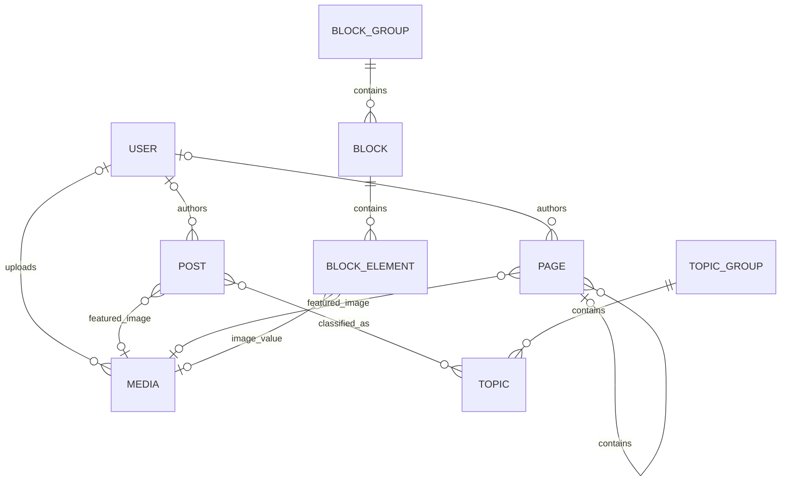
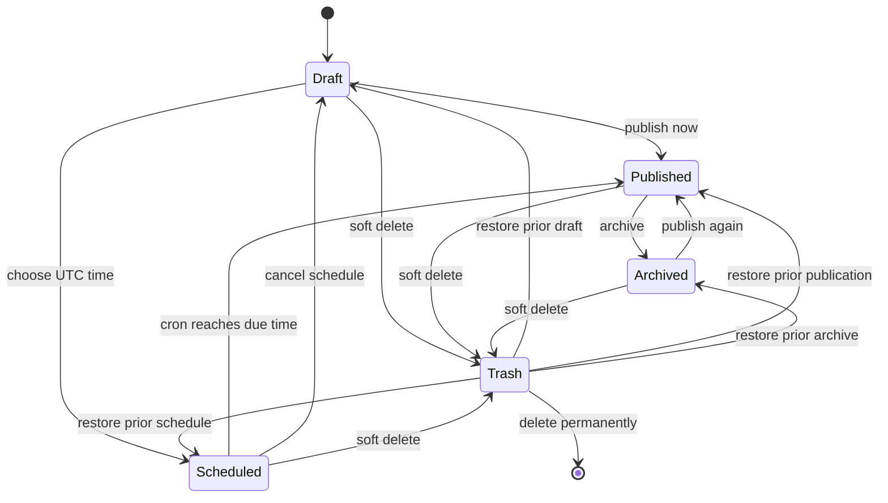

# Content model

VerdinCore models editorial entities explicitly. Authentication and framework tables are documented separately in the [database reference](../reference/database.md).

## Relationship map

## Shared content fields

Posts and pages share the main publishing fields:

| Field group | Purpose |
| --- | --- |
| Identity | Numeric ID, title, unique slug |
| Authorship | Optional user reference |
| Body | Sanitized HTML content and optional excerpt |
| Lifecycle | Status, publication time, created time, updated time, deleted time |
| Audience | `public` or `members` access level |
| Presentation | Featured image, featured flag, review flag |
| Reading data | Word count and estimated reading time |
| Activity | View count and last-viewed time |

Valid content states are `draft`, `scheduled`, `published`, and `archived`. Trash is represented by a soft-delete timestamp rather than a fifth status.

## Posts

Posts are date-oriented content. In addition to the shared fields, a post can be:

- unlisted, which removes it from indexes and discovery surfaces;
- marked as video content;
- assigned to any number of topics;
- republished, which moves its publication time to the current time.

The application can calculate related posts from shared topics and can automatically select featured public posts from an eligible cohort.

## Pages

Pages form a hierarchy through `parent_id`. The full parent chain produces the public URL and breadcrumbs.

The model rejects direct self-parenting and longer parent cycles. Public resolution also verifies that every requested URL segment exactly matches the stored hierarchy and that the whole path is visible to the current audience.

Page-specific fields include:

- `sort_order` for sibling and navigation ordering;
- `is_about` for about/profile structured data;
- `is_contact` for contact-page structured data.

## Topics and topic groups

A topic belongs to one topic group. Posts and topics have a many-to-many relationship through `post_topics`.

This supports two archive levels:

- `/topic/<slug>` for one topic;
- `/topic-group/<slug>` for every post assigned to a topic in that group.

Navigation and sitemap queries include only groups and topics that lead to eligible published content.

## Blocks and block groups

A block group collects blocks. Each block has a globally unique handle, and each element has a handle unique within its block.

Supported element types are:

| Type | Stored value |
| --- | --- |
| `text` | Plain text |
| `rich_text` | Sanitized compact HTML |
| `link` | Validated URL or path |
| `image` | Media reference plus related value data |

Templates can request one element using a `block.element` path or load a complete group as structured objects. Handles are the stable contract between content and presentation.

## Media

The `media` table stores metadata, not image bytes. A record includes the generated filename, original filename, collection, uploader, alt text, caption, and timestamps.

Collections define editorial purpose and processing rules:

- `featured_post`;
- `featured_page`;
- `content`;
- `blocks`.

Featured and content collections generate variants. Block images remain in their accepted original format. See the [media guide](../guides/media.md) for sizes and file behavior.

## Publishing lifecycle

Restoring a deleted post or page clears only its soft-delete timestamp. Its previous status and other content fields remain unchanged. A scheduled item must have a valid UTC publication time before the scheduler can publish it.

## Operational entities

Additional tables store:

- Shield users, identities, groups, permissions, tokens, and login records;
- daily visitor records and summarized statistics;
- cron run status and per-task results;
- synchronized public GitHub repository metadata;
- framework settings and migration state.
