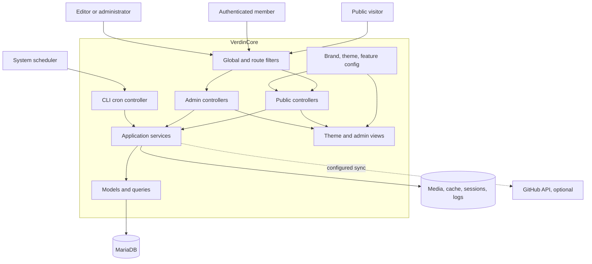
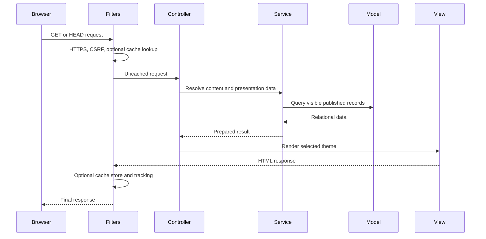

# System architecture

## System context

VerdinCore is a server-rendered CodeIgniter 4 application with three entry surfaces: public HTTP routes, protected administration routes, and a CLI maintenance route. All three use the same services and relational data.

## Application layers

| Layer | Responsibility |
| --- | --- |
| Routes and filters | Declare entry points, apply HTTPS, CSRF, caching, tracking, performance metrics, sessions, and permissions |
| Controllers | Validate request shape, call services or models, choose redirects, JSON responses, or views |
| Services | Own editing, sanitization, analytics, feeds, metadata, structured data, blocks, and cron workflows |
| Models | Define persistence rules, relationships, visibility scopes, publication queries, and admin lists |
| Cells and views | Render reusable server-side components, public pages, auth screens, and dashboard screens |
| Configuration | Select the brand and theme, expose feature flags, and tune operational behavior |
| Build scripts | Compile Tailwind CSS and bundle public and admin JavaScript |

Business rules sit mainly in services and models. This keeps controllers close to HTTP concerns and makes central workflows testable without rendering pages.

## Public request flow

Named routes take precedence. The hierarchical page catch-all is declared last so a page slug cannot shadow `/blog`, `/archive`, `/feed`, `/post/...`, `/topic/...`, or `/topic-group/...`.

## Audience-aware delivery

Public queries use an explicit visibility scope. Guests can retrieve only `public` records. Logged-in users may also retrieve `members` records.

Member-only pages are protected across their full ancestor path. If any page in the path is member-only, a guest receives a 404. Member responses receive private, no-store cache headers and `noindex` directives, and the application does not emit Schema.org data for them.

Unlisted posts remain directly addressable when published, but are excluded from public listing, navigation, sitemap, and automatic-feature queries.

## Administration flow

Every `/admin` route requires an authenticated session plus `dashboard.access`. More specific permissions protect dashboard pages and mutations. Editors can create posts and edit their own posts, while broader content, user, and system operations require the corresponding permission.

Editing services sanitize HTML, normalize input, enforce relationships, and use database transactions where one action updates multiple records. Post saves synchronize topics in the same transaction. Block saves synchronize their elements and media references together.

## Brand and theme separation

`brand.name` selects one configuration under `brands/<brand>/config.php`. `verdincore.theme` selects public views under `app/Views/<theme>/` and front-end sources under `themes/<theme>/`.

The brand supplies identity and deployment metadata. The theme owns presentation. This allows several sites to share core behavior without sharing a visual identity.

Supported brands are registered in `Config\Brand`. Version `4.0.1` includes `portfolio`, `tomgineer`, `verdindynamics`, and `verdincore`.

## Data and files

MariaDB stores authentication, content, taxonomy, block definitions, media metadata, analytics, GitHub repository data, settings, and cron history. The application uses a complete SQL schema for new installations rather than application migrations.

Generated files live outside the application layer:

- `public/images/` contains uploaded media and generated variants;
- `public/sitemap.xml`, `public/sitemap.xml.gz`, and `public/robots.txt` are generated operational files;
- `writable/` contains cache, logs, sessions, uploads, and framework runtime data;
- `public/assets/themes/` contains compiled public and admin bundles.

## Caching and tracking order

The page-cache filter runs before and after controllers. It is active only in production, only when enabled, only for public GET or HEAD requests, and only for guests. A controller must also mark the response as cacheable.

Tracking runs after the response. It therefore does not add a visitor cookie to a cached response. Tracking failures are logged and do not block the completed page response.

## Technology choices

- CodeIgniter 4 provides routing, filters, configuration, services, models, caching, validation, and server-rendered views.
- CodeIgniter Shield provides session authentication, activation, groups, and permissions.
- MariaDB stores relational and operational data.
- Symfony HTML Sanitizer constrains stored rich content.
- Tiptap powers the editing experience.
- Tailwind CSS and daisyUI provide the UI foundation.
- esbuild produces browser bundles.
- PHPUnit covers application services and operational behavior.
