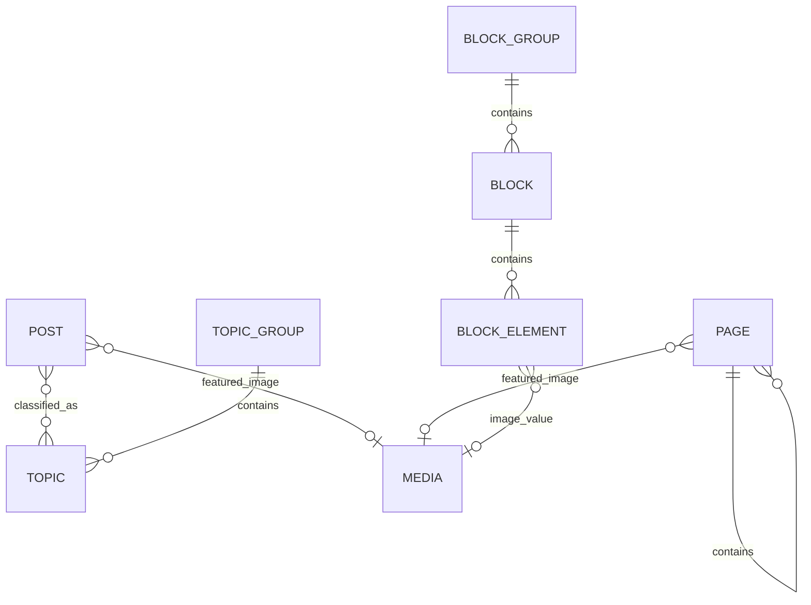
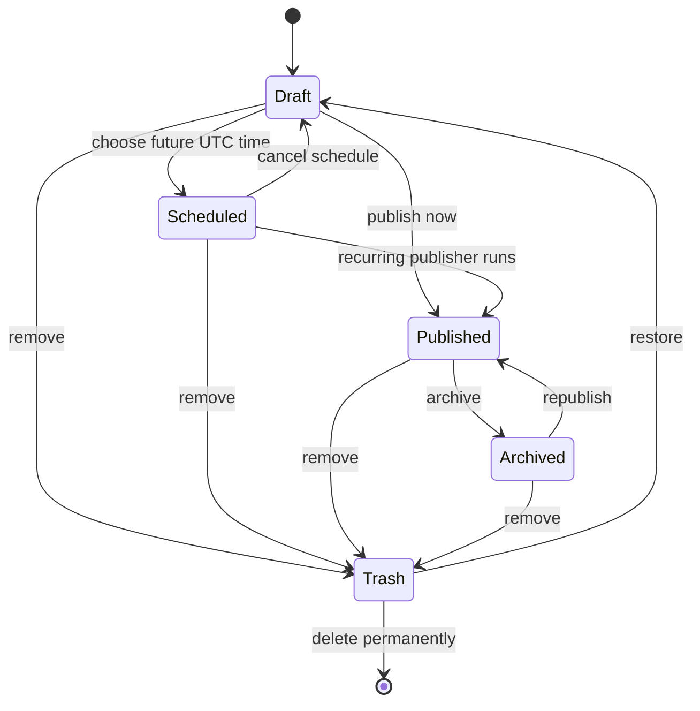

# Content model

VerdinCore uses explicit content entities instead of treating every editable item as an untyped document.

## Relationship map

The diagram focuses on editorial relationships. Authentication and operational tables are intentionally omitted.

## Pages

Pages represent durable, navigable site content.

- A page can have a parent page.
- Parent relationships form the public URL path and breadcrumb trail.
- Circular hierarchy relationships are rejected.
- Only published hierarchy paths resolve publicly.
- Pages can be featured and ordered for navigation.
- Specialized flags can identify contact and about pages for presentation and structured data.
- Pages support draft, scheduled, published, and archived states plus soft deletion.

## Posts

Posts represent date-oriented published content.

- Posts have unique slugs, excerpts, body content, publication times, and optional featured media.
- Posts support draft, scheduled, published, and archived states plus soft deletion.
- Published posts can appear in home, blog, archive, topic, related, featured, popular, and recently viewed contexts.
- View totals and last-viewed timestamps are maintained independently from daily visitor summaries.

## Topics and topic groups

Topics classify posts through a many-to-many relationship. Topic groups organize related topics into a higher-level taxonomy.

This supports both narrow archives, such as a single topic, and broader archives that include posts assigned to any topic within a group.

## Blocks and block groups

Blocks provide reusable structured content outside the main page and post bodies.

- Each block has a stable handle used by templates.
- A block contains ordered elements.
- Supported element types are text, rich text, link, and image.
- Each element has its own handle, allowing templates to request meaningful values rather than positional fields.
- Block groups collect and order related blocks.

This model is useful for reusable calls to action, profile details, link collections, promotional panels, and other content that should remain editable without becoming a full page.

## Media

Media records connect generated files to their editorial purpose. Collections distinguish featured post images, featured page images, inline content images, and block images.

The platform generates configured image variants and records dimensions and file metadata. Cleanup tasks detect media that no longer has a valid content reference.

## Publishing lifecycle

The exact restored status is an application concern, but the dashboard exposes restore and permanent deletion as separate actions.

## Supporting models

Additional records support:

- users and authentication identities;
- visitor counts and aggregated summaries;
- cron execution history;
- synchronized public GitHub repository data;
- application settings and framework migrations.
