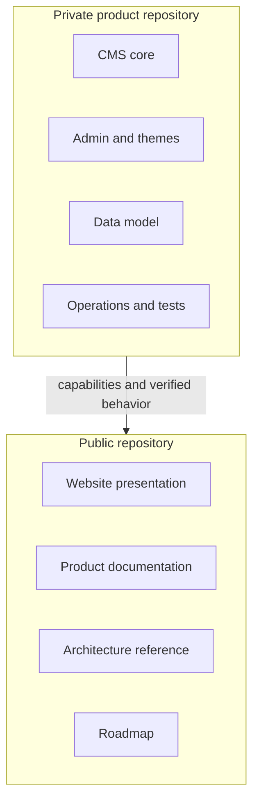

# Platform overview

## Purpose

VerdinCore is a private content platform for websites that need a strong publishing foundation without inheriting the weight or assumptions of a general-purpose site builder.

The platform starts with familiar CMS capabilities, then separates brand identity, presentation, and optional features from the shared application core. This makes it possible to evolve the platform once and apply those improvements across multiple distinct websites.

## Product principles

### Shared foundation

Content rules, administration, security, media handling, SEO, analytics, and maintenance belong to one core. Repeated platform work should be solved once.

### Independent identity

A website is more than a different logo. Each deployment can carry its own name, description, author, domain, locale, contact details, social presence, visual assets, structured identity, theme, and feature configuration.

### Structured content

Pages, posts, taxonomies, blocks, and media are modeled explicitly. Clear relationships make navigation, archives, related content, search-engine metadata, and future integrations easier to reason about.

### Server-rendered delivery

Public pages are rendered on the server. The browser receives complete HTML, while JavaScript is used selectively for interactions and the administrative editing experience.

### Operational completeness

Publishing does not end when content is saved. Cache behavior, scheduled publication, media lifecycle, sitemaps, robots directives, analytics summaries, logs, and job history are part of the product.

### Controlled evolution

The core source remains private. Public documentation makes the architecture and product direction understandable without turning this repository into a source distribution.

## Who it is for

VerdinCore is designed for:

- editorial websites and blogs;
- personal, portfolio, and company websites;
- multiple branded sites that benefit from a shared engineering foundation;
- teams that prefer explicit server-side architecture and controlled dependencies;
- projects that need custom presentation without rebuilding publishing infrastructure.

It is not currently presented as a hosted no-code service, a downloadable open-source package, or a general plugin marketplace.

## Platform boundaries

The public repository explains what VerdinCore is and how it is organized. The private repository remains the source of truth for implementation details and releases.

## Core terminology

| Term | Meaning |
| --- | --- |
| Core | The shared application, domain logic, persistence, admin tools, and operational services |
| Brand | Site identity and deployment-specific metadata, assets, and integrations |
| Theme | Server-rendered templates and front-end assets for public presentation |
| Deployment | A configured instance of the core serving a particular website |
| Block | A reusable structured content unit addressed by a stable handle |
| Block group | An ordered collection of related reusable blocks |

## Current state

The platform is in active private development and already powers the product direction presented at [verdincore.com](https://verdincore.com). Existing capabilities are documented separately from planned work so this repository can remain a reliable public reference.

