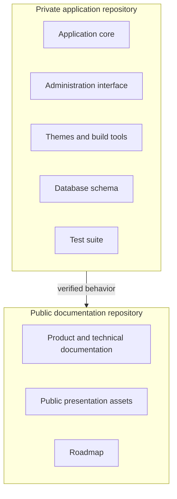

# Platform overview

## Purpose

VerdinCore is a content platform for sites that need custom presentation without rebuilding the publishing foundation each time. It keeps the application core, brand identity, and public theme as separate concerns.

A deployment is the combination of:

```text
shared application core
+ selected brand configuration
+ selected public theme
+ environment settings
= one website
```

The result is not a generic page builder. It is a controlled publishing system with explicit content types, a protected administration area, and a defined operational lifecycle.

## Product principles

### One core, several identities

Publishing rules, security, media handling, analytics, metadata, and maintenance live in the shared core. Each deployment supplies its own name, domain, locale, contact data, social links, structured identity, visual assets, and theme.

### Structured content

Posts, pages, topic groups, topics, blocks, block elements, and media are separate entities with clear relationships. Templates can work with meaningful fields and handles instead of parsing an unstructured document.

### Server-rendered delivery

Public pages are rendered as complete HTML. Browser JavaScript supports interactions and the administration interface, but it is not required to assemble the public page.

### Publishing includes operations

Scheduled publication, page-cache invalidation, media cleanup, analytics summaries, sitemap generation, robots checks, logs, and job history are part of the application rather than separate manual tasks.

### Private source, documented behavior

The application is proprietary. This repository documents the product and its verified behavior without publishing the private implementation.

## Suitable uses

VerdinCore is designed for:

- editorial sites and blogs;
- personal, portfolio, and company sites;
- several branded sites that share an engineering foundation;
- teams that prefer explicit server-side architecture;
- projects that need a tailored front end with a focused editorial back end.

It is not currently offered as a hosted no-code service, an open-source download, or a plugin marketplace.

## Core terms

| Term | Meaning |
| --- | --- |
| Core | Shared application code, domain rules, persistence, admin UI, and maintenance services |
| Brand | Deployment identity, contact details, social presence, structured identity, and assets |
| Theme | Public PHP views plus CSS and JavaScript source files |
| Deployment | One configured instance serving one website |
| Block | Reusable structured content addressed by a stable handle |
| Block group | A named collection of blocks |
| Collection | A media usage category with its own storage and processing rules |

## Public and private boundaries



## Current state

The documentation reflects version `4.0.1`. The application is under active private development, so version-specific behavior should be rechecked when the private core changes.
